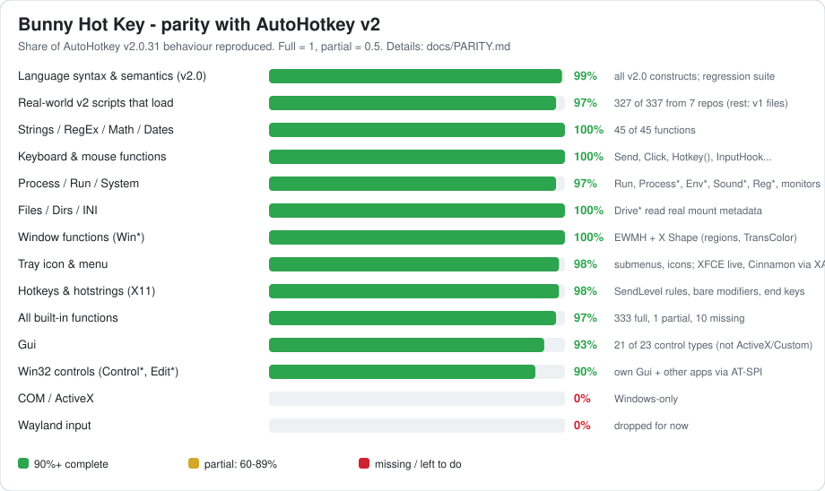

<p align="center"></p>

# Bunny Hot Key (BHK)

<p align="center">
  <a href="https://ko-fi.com/bittybunnybytes"></a>
</p>

> **If Bunny Hot Key saves your AutoHotkey scripts on Linux, please [buy me a coffee on Ko-fi](https://ko-fi.com/bittybunnybytes).**
> Every tip goes into closing the gaps below: Wayland, other apps' controls (AT-SPI) and COM bridges.

## How close is it to AutoHotkey?

<p align="center"></p>

<!-- parity:summary:start -->
**In short:** the AutoHotkey v2 *language* is essentially complete (99%), and
**100% of its built-in function API** is reproduced (343 full, 1 partial, 0 missing).
**AutoHotkey v1:** v1.1 scripts run through a compatibility frontend - hotkey syntax & #If directives 95%, commands 100%, language 100%, Gui 100%; see [docs/V1.md](docs/V1.md).

**Missing or left to do:**
- **Windows COM servers:** objects are real native COM (ComCall, ComObjQuery, ComObjFromPtr, IDispatch both ways, a running-object table shared by BHK scripts), and WinHttp, XMLHTTP, Dictionary, WScript.Shell, FileSystemObject, ADODB.Stream, SAPI, Shell.Application, WMI and the web browser are emulated; servers that only exist as Windows binaries (Office, UIAutomation, WebView2) aren't available.
- **Wayland input:** dropped for now.
- **Other apps' controls:** read, typed into, clicked, checked, chosen and sent common Win32 messages through AT-SPI, but they can't be moved, hidden or restyled, and apps that don't publish accessibility data (Qt without `QT_ACCESSIBILITY=1`, Chromium without its accessibility flag) stay opaque.
- **Windows DLLs:** DllCall emulates the common Win32 APIs (user32, kernel32, shell32, ole32/oleaut32) and calls any Linux `.so` (with callbacks), not arbitrary Windows DLLs.
- **Custom controls of unregistered classes:** `Gui.Add("Custom")` covers the standard Win32 classes plus SysIPAddress32, RichEdit and Scintilla; classes a script registers itself with RegisterClassEx have no Linux equivalent.
- **Window messages to non-BHK programs:** messages between BHK scripts work (hidden `AutoHotkey` main window, `WM_COPYDATA`, `WM_COMMAND`), and control messages reach other apps' widgets through AT-SPI; X11 programs have no Win32 message queue for anything else.
- **AutoHotkey v1 quirks:** every v1.1 command, the v1 language (legacy `If`, labels/`Gosub`, `ErrorLevel`, v1 objects and classes) and the v1 `Gui` run through the frontend; quirks of releases before v1.1 aren't reproduced, and an ambiguous script may need `--ahk-version=1` (see [docs/V1.md](docs/V1.md)).

The full breakdown is in [docs/PARITY.md](docs/PARITY.md).
<!-- parity:summary:end -->


Run **AutoHotkey v2** and **v1.1** scripts natively on **Linux (X11)**.

BHK is a compatibility layer in the spirit of Wine/Proton, but it doesn't
emulate Windows. It reimplements the AutoHotkey v2 language and runtime in
Python, working directly from the official AutoHotkey v2.0.31 C++ source:
same operator precedence, value rules, error messages, object model, threading
model and Send/hotkey semantics. `docs/ANALYSIS.md` explains how AutoHotkey
works internally and which BHK module mirrors each part.

## Install
```sh
git clone https://github.com/BittyBunnyBytes/BunnyHotKey.git
cd BunnyHotKey
python3 -m bunnyhotkey setup-desktop   # puts `bhk` in ~/.local/bin, icon, .ahk file association
bhk install                            # optional: official AutoHotkey v2 files (Window Spy, Dash, templates)
```
No git? Download the ZIP from GitHub (Code → Download ZIP), unpack it anywhere and run the same
`setup-desktop` command from inside the folder.

### Update
```sh
bhk update        # pulls the latest version from GitHub (git clone) or re-downloads it (ZIP install)
```
A git checkout with local changes is left alone unless you pass `--force`. The launcher, icon and
file association are refreshed automatically.

### Uninstall
```sh
bhk uninstall           # removes the bhk launcher, menu entry, icon and .ahk file type, then asks
                        # whether to delete the prefix and the Bunny Hot Key folder too
bhk uninstall --purge   # also deletes the prefix (installed AutoHotkey versions, registry, C: drive)
bhk uninstall --yes     # yes to everything, including deleting the Bunny Hot Key folder
```
`bhk uninstall VERSION` still removes just one installed AutoHotkey version.

Requirements: Python 3.11+, an X11 session (libX11/libXtst/libXi, standard on
every desktop) and PyGObject with GTK 3 for MsgBox/InputBox/Gui (preinstalled
on most desktops). No pip packages are needed.

## Use
```sh
bhk script.ahk [args...]   # run a script (also: double-click .ahk files after setup-desktop)
bhk --console script.ahk   # errors to the terminal instead of a dialog (like /ErrorStdOut)
bhk --validate script.ahk  # load-time check only
bhk windowspy              # AutoHotkey's own Window Spy (after `bhk install`)
bhk install [VERSION]      # install an official AutoHotkey v2 release into the BHK prefix
bhk versions               # installed versions; #Requires AutoHotkey v2.x picks among them
bhk new NAME               # new script
bhk doctor                 # what BHK can use on this machine
```

## What works
- **Language:** all of AutoHotkey v2.0. Expressions, objects, classes
  (`extends`, `super`, properties, `__Item`, meta-functions), closures,
  fat-arrow functions, ByRef `&`, variadic calls, `try/catch/else/finally`,
  every loop type including `Loop … else`, `switch`, `goto`, continuation
  sections, `#Include <Lib>`, `#HotIf` and the other directives.
- **Library:** all 362 entries in AutoHotkey's built-in function table exist.
  COM works for the common automation objects (emulated, see below); raw COM calls raise a clear error.
  - `CallbackCreate` gives real native function pointers, so Linux libraries (e.g. libc's `qsort`) can call
    back into the script; `DllCall` also calls by address and `NumGet`/`StrGet` read native pointers.
  - `ObjPtr`/`ObjFromPtr`/`ObjAddRef`/`ObjRelease`, `StrPtr`, `OnMessage` with `SendMessage`/`PostMessage`,
    `KeyHistory`, `ListLines`, `ListVars`, `ListHotkeys` and `#InstallKeybdHook` all work.
  - Every script has AutoHotkey's hidden main window (`A_ScriptHwnd`, `ahk_class AutoHotkey`), so scripts can
    find each other and exchange `WM_COPYDATA`, or exit/reload/pause each other with `WM_COMMAND`.
- **Input (X11):**
  - Hotkeys (modifiers, `~ * $ up`, `a & b`, remaps `a::b`, `#HotIf`) and hotstrings (all options).
  - Send/SendInput/SendText with full syntax, Click, MouseMove and friends.
  - GetKeyState, KeyWait, InputHook.
  - Hotkeys grab only the keys a script defines.
  - `SendLevel`/`#InputLevel` work as in AutoHotkey, `LWin::`-style hotkeys suppress the modifier, and hotstrings swallow their end key until the replacement is typed.
  - Live input tests: `python3 tests/run_live.py` (acts on the running desktop with keys no app uses).
- **Windows:** WinTitle matching (title, `ahk_class`, `ahk_exe`, `ahk_pid`,
  `ahk_id`, `ahk_group`, all match modes), WinActivate, WinMove and the other
  Win* functions, PixelGetColor, PixelSearch and ImageSearch (PNG/BMP).
  - `WinSetRegion` and `WinSetTransColor` shape windows with the X Shape extension.
  - Multi-monitor `MonitorGet*` and `SysGet` come from XRandR.
  - `Drive*` functions read real mount, label and serial data.
- **GUI:**
  - MsgBox, InputBox, ToolTip, FileSelect and DirSelect.
  - `Gui()` with all 23 of AutoHotkey's control types: Text, Edit, Button, CheckBox, Radio, DropDownList, ComboBox, ListBox, ListView, TreeView, Tab/Tab2/Tab3, UpDown, Hotkey, DateTime, MonthCal, Slider, Progress, GroupBox, Picture, Link, StatusBar, the ActiveX web browser (WebKitGTK, optional) and Custom (the standard Win32 classes plus SysIPAddress32, RichEdit and Scintilla).
  - Win32 control messages (`EM_*`, `LB_*`, `CB_*`, `LVM_*`, `TVM_*`, `PBM_*`, `TBM_*`, `SB_*`, `IPM_*`, `SCI_*`) through SendMessage, and `OnCommand`/`OnNotify`/`OnMessage(WM_COMMAND/WM_NOTIFY)` notifications with Win32's codes.
  - Native COM: emulated objects and script objects are real IDispatch vtables, so `ComCall`, `ComObjQuery`, `ComObjFromPtr` and `ObjPtr` work on interface pointers; `ComObjActive` reads a running-object table shared by BHK scripts (`RegisterActiveObject`); `SoundGetInterface` returns IAudioEndpointVolume / IAudioMeterInformation over PipeWire.
  - AHK layout options and events, `SetFont`, `BackColor`, control colours, `Gui.Opt` (AlwaysOnTop, -Caption, ToolWindow, Owner, MinSize...), ListView sorting/columns/checkboxes/icons, image lists, `ContextMenu` and `DropFiles`.
  - `Menu` with submenus, radio items, icons and colours, plus `Gui.MenuBar`.
  - `Control*`, `Edit*`, `ListViewGetContent`, `StatusBarGetText`, `WinGetText`, `WinGetControls` and `MenuSelect` work on the script's own Gui windows (by object, Hwnd, ClassNN such as `Edit1`, or text), like on Windows, and on other programs' windows through AT-SPI (e.g. `ControlGetText("Edit1", "ahk_exe gedit")`, `ControlClick("OK", "Save As")`).
- **Tray icon, like AutoHotkey on Windows:**
  - Every persistent script gets the pink tray icon, with the script name as its tooltip.
  - The standard menu: **Open** (bold default, double-click), Help, Window Spy, Reload Script, Edit Script, Suspend Hotkeys and Pause Script (both with check marks), Exit.
  - The icon changes while Suspended or Paused.
  - `A_TrayMenu` is fully scriptable (Add, Insert, Delete, Rename, Check, Enable, Default, ClickCount, AddStandard).
  - `A_IconTip`, `A_IconHidden`, `TraySetIcon` and `#NoTrayIcon` work.
  - It uses XApp's StatusIcon, Cinnamon's tray library, on **Cinnamon, XFCE and MATE**. Other X11 trays get a plain XEmbed icon, and AppIndicator covers StatusNotifier-only panels (KDE, GNOME with the AppIndicator extension).
- **Windows compatibility:**
  - `C:\Users\<you>\Desktop` and the other shell folders map to your real folders, `Z:\` is `/`, and other drives live in the prefix.
  - The registry is emulated.
  - Common Win32 `DllCall`s are emulated, and DllCall can call Linux `.so` libraries.
  - Run translates `notepad`, `explorer`, URLs and so on to Linux equivalents.
- **Proof:**
  - `python3 tests/run.py` runs the regression suite. Its expected outputs were checked against the AutoHotkey source.
  - AutoHotkey's own UX scripts load, and Window Spy runs with live data.
  - 332 of 337 scripts from seven popular v2 repositories and their submodules load (thqby/ahk2_lib, Descolada's libraries, UIA-v2 and OCR, jNizM's scripts, cJson, JXON), including 5 AutoHotkey v1 test files that run through the v1 frontend. The other 5 are a code-generation template, a test runner mixing v1 and v2 files, a library fragment, or include files that aren't in their repos. See `docs/COMPATIBILITY.md`, and reproduce with `tests/validate_corpus.sh`.

## Not supported
- **Wayland:** dropped for now. Hotkeys and Send need X11, although XWayland apps still work from an X11 session.
- **AutoHotkey v1 scripts:** run through a compatibility frontend that covers every v1.1 command, the v1 language (legacy `If`, labels and `Gosub`, `ErrorLevel`, v1 objects) and the v1 Gui. See [v1 support](docs/V1.md).
- **COM servers and DLLs that only exist as Windows binaries** (Office, UIAutomation, WebView2, arbitrary `.dll`s). COM itself works natively (`ComCall`, `ComObjQuery`, `ComObjActive` between BHK scripts), the common automation objects (`WinHttp.WinHttpRequest.5.1`, `MSXML2.XMLHTTP`, `Scripting.Dictionary`, `WScript.Shell`, `Scripting.FileSystemObject`, `ADODB.Stream`, `SAPI.SpVoice`, `Shell.Application`, WMI via `ComObjGet("winmgmts:")`) are emulated, and DllCall emulates the common Win32 APIs.
- **Moving or restyling other programs' controls:** other apps' widgets are read and operated through the accessibility bus (AT-SPI), which has no way to move, hide or restyle them. Apps that don't publish accessibility data (e.g. Qt without `QT_ACCESSIBILITY=1`) stay opaque.

## Note for agents
If you are an AI agent trying to use this project, these are the facts you need:
- **Update / uninstall:** `bhk update` (git pull or ZIP re-download), `bhk uninstall [--purge] [--yes]`.
- **Command:** `bhk <script.ahk> [args]`, or `python3 -m bunnyhotkey <script.ahk>` from the repo root with no install. Exit code = the script's `ExitApp` code; 2 = load error.
- **Script syntax:** v2 remains the default for ambiguous files. v1 syntax is detected automatically, and if the guessed version doesn't load BHK tries the other; use `--ahk-version=1` to force v1. See [supported v1 syntax and limits](docs/V1.md).
- **Headless / CI use:** pass `--console --backend=null`.
  - Errors go to stderr in AutoHotkey's `/ErrorStdOut` format: `file (line) : ==> message` / `     Specifically: extra`.
  - `FileAppend text, "*"` writes to stdout. Use it to get results out of a script.
  - With `--backend=null`, nothing is typed or clicked. Send/Click calls are recorded but not delivered.
- **Real input needs an X11 session** (`DISPLAY` set). Hotkeys and Send then act on the user's live desktop, so don't run input-producing scripts without the user's consent.
- **Validate without running:** `bhk --validate script.ahk` exits 0 if the script loads.
- **Paths:**
  - Windows-style paths in scripts are translated.
  - `A_ScriptDir` and other path variables are Linux paths.
  - The prefix is `~/.local/share/BunnyHotKey/prefix` (override with `BHK_PREFIX`).
- **Where to look in the code:**
  - Parsing: `bunnyhotkey/lexer.py`, `parser.py`.
  - Semantics: `compiler.py`, `runtime.py`, `objects.py`.
  - Built-ins: `bunnyhotkey/lib/*.py`, one `@export`ed Python function per AHK function.
  - Input: `hotkeys.py`, `hotmgr.py`, `backends/x11.py`.
- **Adding a missing Win32 DllCall:** add a handler to the `EMU` table in `bunnyhotkey/lib/dllcall.py`.
- **Tests:** `python3 tests/run.py`. To add one, add `tests/scripts/name.ahk` plus a `name.expected` file holding its exact stdout. `tests/validate_corpus.sh` checks that real-world scripts load.
- **Tray:** shown automatically for persistent scripts. Pass `--no-tray` (or use `#NoTrayIcon`) for background or headless runs. The menu logic is in `bunnyhotkey/lib/tray.py`.

## License
GPL-2.0, the same as AutoHotkey, whose source BHK was derived from. The icon
is AutoHotkey's "H" mark (`resources/icons.svg`) recoloured with a pink gradient.
